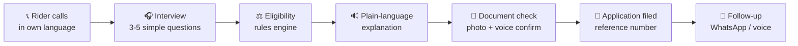
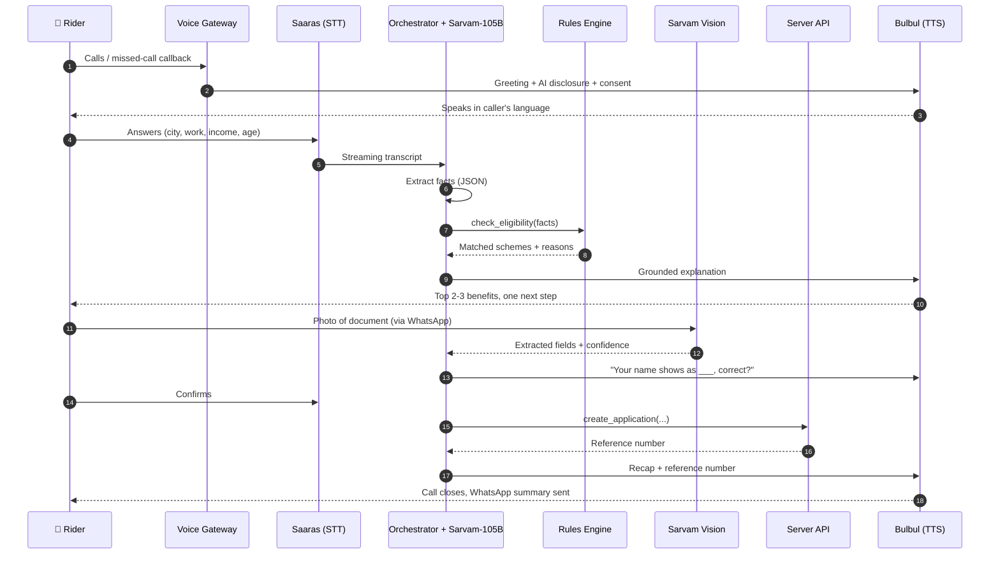
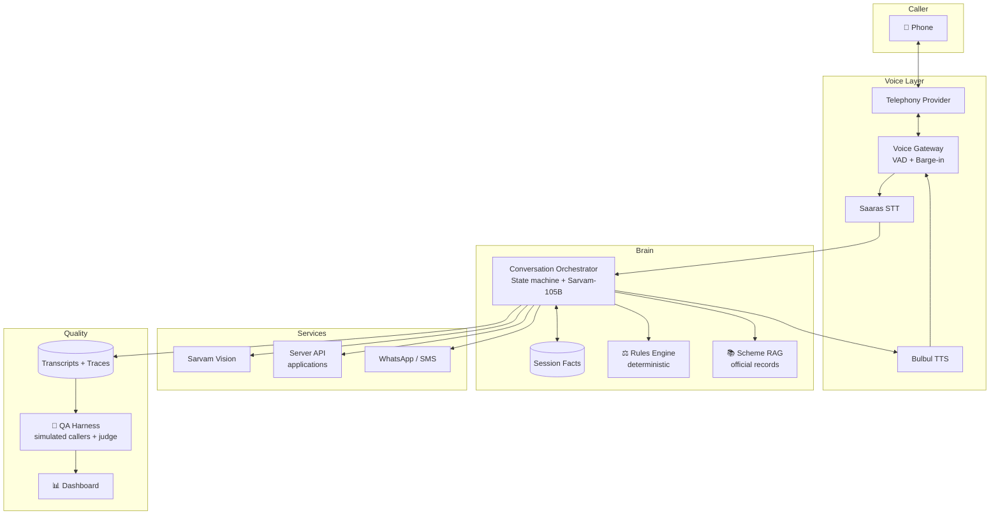
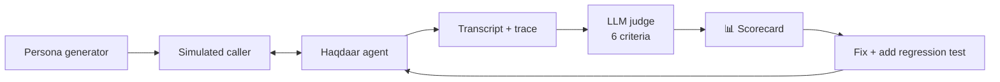

<div align="center">

# 🎙️ Haqdaar

### A voice agent that helps gig workers find and claim the government benefits they deserve, over a plain phone call, in their own language.


*"Haqdaar" (हक़दार) means "rightful claimant": someone entitled to what is theirs.*

</div>

---

## 📖 Table of Contents
- [The Problem](#-the-problem)
- [What Haqdaar Does](#-what-haqdaar-does)
- [How a Call Works](#-how-a-call-works)
- [Architecture](#-architecture)
- [Design Principles](#-design-principles)
- [Tech Stack](#-tech-stack)
- [Project Structure](#-project-structure)
- [Getting Started](#-getting-started)
- [Testing and QA](#-testing-and-qa)
- [Roadmap](#-roadmap)
- [Privacy and Safety](#-privacy-and-safety)
- [Contributing](#-contributing)

---

## 🚨 The Problem

Delivery riders and gig workers are often eligible for social security, insurance, pension and health schemes, but most never claim them:

| Barrier | Why it blocks people |
|---|---|
| 📱 **Device** | Many use basic phones with no app or reliable data |
| 🗣️ **Language** | Portals and forms are in English or formal language |
| 📄 **Paperwork** | Unclear which documents are needed or how to submit |
| 🧭 **Discovery** | They don't know which schemes exist or whether they qualify |

**Voice is the only interface that works for everyone.** Haqdaar turns a phone call into the whole journey: discovery, eligibility, documents, application and follow-up.

---

## ✨ What Haqdaar Does



- 🗣️ **Natural multilingual conversation** with barge-in (the caller can interrupt anytime)
- ⚖️ **Deterministic eligibility** in code, never decided by the LLM
- 📚 **Grounded answers** that cite the official scheme clause behind every claim
- 📸 **Document understanding** using Sarvam Vision, with spoken read-back of every field
- 🙋 **Human handoff** when the caller is confused, distressed or reports a scam
- 🧪 **Built-in QA harness** with simulated callers scored automatically

---

## 📞 How a Call Works



### Call stages

| # | Stage | Exit condition |
|---|---|---|
| 1 | 👋 Greeting + AI disclosure + consent | Consent given |
| 2 | 🌐 Language detect and confirm | Language set |
| 3 | 🎧 Interview | Minimum facts collected |
| 4 | ⚖️ Eligibility check | Result returned |
| 5 | 🔊 Explain benefits | Caller picks one or none |
| 6 | 📸 Document capture and voice confirmation | All fields confirmed |
| 7 | 📝 Signup via API | Reference number issued |
| 8 | ✅ Close and WhatsApp summary | Call ends |
| 9 | 🔔 Follow-up status updates | Application resolved |

---

## 🏗️ Architecture



---

## 🧭 Design Principles

1. **The LLM talks; code decides.** Eligibility lives in a tested rules engine. The model only extracts facts and explains results.
2. **No source, no claim.** Every benefit amount, rule or deadline spoken must trace to a scheme record with a `source_url` and `last_verified` date.
3. **One question at a time.** Short turns, simple words, numbers repeated back.
4. **Confirm before commit.** Nothing is submitted until every document field is confirmed by voice.
5. **Fail safe.** When unsure, the agent says so and offers a human.
6. **Test like production.** Narrowband phone audio, noise, interruptions and difficult callers.

---

## 🧰 Tech Stack

| Layer | Technology |
|---|---|
| 🎤 Speech-to-text | Saaras (streaming) |
| 🧠 LLM | Sarvam-105B with tool calling |
| 🔊 Text-to-speech | Bulbul v3 (streaming) |
| 👁️ Documents | Sarvam Vision |
| ☎️ Telephony | Exotel (production), browser mic (development) |
| 💬 Messaging | WhatsApp Cloud API |
| ⚙️ Backend | Python 3.11, FastAPI, asyncio, WebSockets |
| 🗄️ Storage | SQLite (dev), Postgres (prod) |
| 🔎 Retrieval | pgvector / Chroma / FAISS |
| 📊 Dashboard | Next.js or FastAPI templates |

> Each provider sits behind an interface and can be swapped or mocked.

---

## 📂 Project Structure

```
haqdaar-voice-agent/
├── app/
│   ├── gateway/            # telephony, audio stream, VAD, barge-in
│   ├── orchestrator/       # state machine, LLM loop, tool dispatch
│   ├── rules/              # deterministic eligibility engine
│   ├── rag/                # scheme retrieval
│   ├── tools/              # agent tools (eligibility, documents, apply...)
│   ├── integrations/       # sarvam, whatsapp, server API, mock_api.py
│   └── utils/              # spoken-number parser, masking, logging
├── prompts/                # versioned master prompts
├── data/schemes/           # scheme records with sources + last_verified
├── qa/                     # simulated callers, judge, scenarios
├── dashboard/              # call list, traces, QA scorecard
├── tests/                  # unit + scenario tests
├── reports/                # QA run reports
├── DECISIONS.md            # assumptions, API gaps, TODO_VERIFY items
├── .env.example
└── README.md
```

---

## 🚀 Getting Started

### Prerequisites
- Python 3.11+
- Sarvam API key
- (Optional) Exotel and WhatsApp Cloud API credentials. Without them, the browser-mic client and console messaging are used.

### Setup

```bash
# 1. Clone
git clone https://github.com/<your-username>/haqdaar-voice-agent.git
cd haqdaar-voice-agent

# 2. Install
python -m venv .venv && source .venv/bin/activate
pip install -r requirements.txt

# 3. Configure
cp .env.example .env        # then fill in your keys

# 4. Run tests
pytest

# 5. Start the agent (browser-mic dev mode)
uvicorn app.main:app --reload
```

### Key environment variables

| Variable | Purpose |
|---|---|
| `SARVAM_API_KEY` | Speech, LLM and vision access |
| `SERVER_API_BASE_URL` / `SERVER_API_KEY` | Application backend (mock by default) |
| `TELEPHONY_*` | Exotel credentials (optional in dev) |
| `WHATSAPP_API_TOKEN` | WhatsApp Cloud API (optional in dev) |
| `RETENTION_DAYS` | Data retention period |

See `.env.example` for the full list.

---

## 🧪 Testing and QA



**Judge criteria (1 to 5):** groundedness · one question at a time · language match · consent · escalation correctness · resolution

**Stress scenarios:** constant interruptions · vague income · wrong-then-corrected numbers · traffic noise · loan or legal advice requests · scam suspicion · mid-call language switch · long silences · attempts to extract ungrounded amounts

**Target:** zero groundedness failures; at least 90% of runs scoring 4 or above on every criterion.

---

## 🗺️ Roadmap

- [x] Product spec and master prompts
- [ ] **Phase 1:** scheme knowledge base, rules engine, spoken-number parser, tool stubs
- [ ] **Phase 2:** Hindi voice loop with barge-in and latency tracking
- [ ] **Phase 3:** documents, signup, WhatsApp follow-up, Marathi, human handoff
- [ ] **Phase 4:** QA harness with 50 to 100 simulated callers
- [ ] **Phase 5:** dashboard with grounding traces, demo script
- [ ] Future: more languages, state-level scheme packs, status-check inbound line, accessibility for low-literacy callers

---

## 🔐 Privacy and Safety

- 🤖 The agent states it is an AI at the start of every call
- ✅ Recording and data collection require explicit consent, stored with a timestamp
- 🚫 The agent never asks for OTPs, PINs, passwords or card numbers
- 🎭 Aadhaar and other identifiers are masked in logs and the dashboard
- 🗑️ Retention limits with an automatic deletion job
- 🔒 Documents and recordings encrypted at rest
- 🚨 Scam reports and emergencies trigger immediate human escalation

> ⚠️ Haqdaar assists with applications and does not guarantee approval. Scheme details must be verified against official government sources before use.

---

## 🤝 Contributing

1. Fork the repo and create a branch: `git checkout -b feature/your-feature`
2. Add tests for any new rule, tool or prompt change
3. Run `pytest` and the QA suite before opening a PR
4. For scheme data, include `source_url` and `last_verified` for every record

---

## 📄 License

MIT. See [LICENSE](LICENSE).

<div align="center">

**Built so that every rider can claim what is rightfully theirs. 🛵**

</div>
